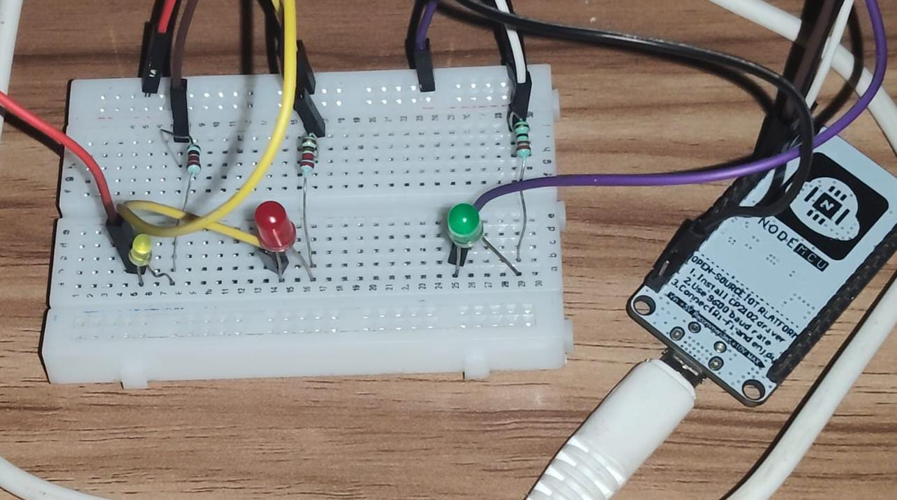
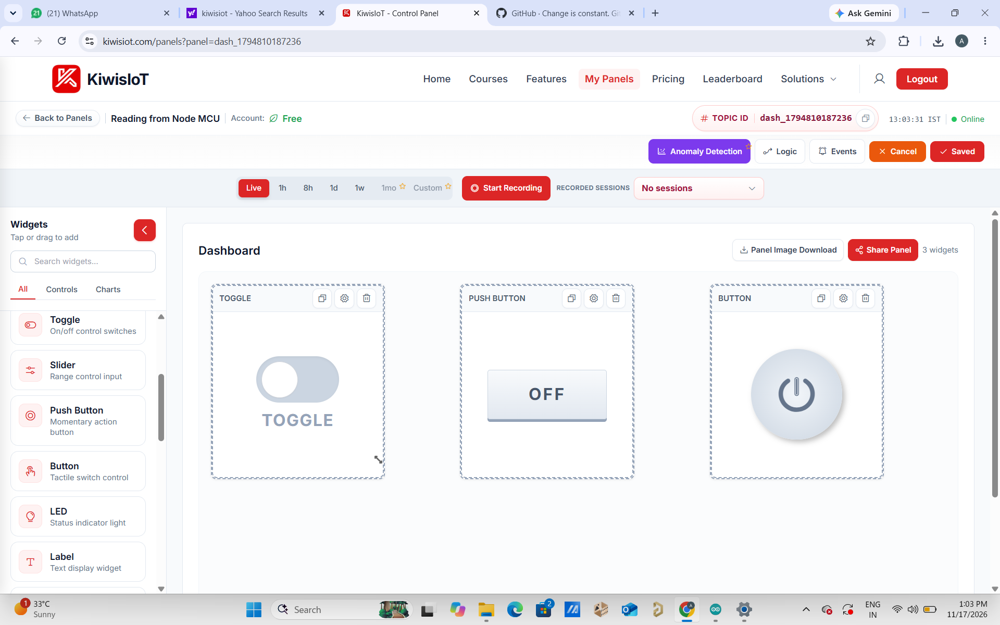

# LED-control-using-KiwisIoT
# Three LED Control Using NodeMCU and KiwisIoT
# Description
This project controls three LEDs (Red, Green, and Yellow) using NodeMCU ESP8266 through the KiwisIoT IoT platform. Each LED is controlled independently using three separate dashboard channels.
# Components Required
- NodeMCU ESP8266
- Red LED
- Green LED
- Yellow LED
- 3 × 220Ω resistors
- Breadboard
- Jumper wires
- Wi-Fi connection
## Source Code
[ledcontrol.ino](ledcontrol.ino)

## Images

# Working
- Channel 0 controls the Red LED.
- Channel 1 controls the Green LED.
- Channel 2 controls the Yellow LED.
- Each LED can be switched ON or OFF independently through the KiwisIoT dashboard.
# Platform Used
- Arduino IDE
- KiwisIoT Dashboard
- NodeMCU ESP8266
